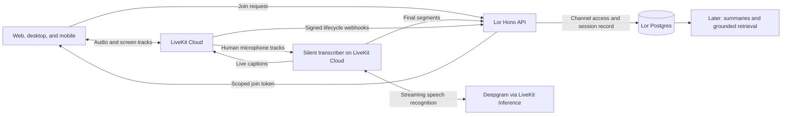

# Voice channels: LiveKit Cloud research

> Archived 2026-10-06: research input only; decisions in [`voice-channels.md`](../voice-channels.md) win where they differ.

**Researched:** 2026-09-27  
**Tracking:** LOR-79 — Voice Channels/ voice AI (issue details supplied by Jacob)  
**Status:** Research and proposed implementation direction; no voice implementation added.

**Superseded in part — 2026-09-28:** later product decisions live in
[voice-channels.md](../voice-channels.md) ("Voice channel model") and are executed
from the [runbook](../voice-channels-runbook.md); where they differ from this
research, they win. Main changes: camera video is in the MVP; phones never
publish screen shares; transcription is always on, with a per-device captions
toggle and no stop control; each session has its own chat and lives in the
voice channel's history instead of a chat card; a session ends two minutes
after the last person leaves.

**Initial provider decision — 2026-09-27:** Use LiveKit Cloud for calls and
LiveKit Inference for transcription, with Deepgram Nova-3 as the initial model
candidate. Keep one room transcriber with separate participant STT streams.
Defer direct Deepgram/BYOK and custom silence filtering until real usage justifies
the additional complexity. Prioritize reliable capture over reducing billed
silence in the first version; budget for per-participant connection time.

Participant attribution comes from each user's track. The deferred optimization
is voice activity detection for deciding which audio to send, not identifying
which participant owns a track. A shared voice package can include transcription.

Recommendation: use LiveKit Cloud for human calls, build Lor's UI around its SDKs,
and add a silent transcription service with durable storage in Lor. Resolve Tauri
screen capture and native mobile call lifecycle first. Spoken Lor, summaries,
retrieval, and transcript Q&A can follow without replacing the call foundation.

## What was already written

| Location | What it establishes |
| --- | --- |
| [Voice channels and shared memory](../voice-channels.md) | The detailed guiding spec, dated September 24 and committed September 25 in `bbd2ecd0`. Drop-in voice, screen sharing, navigation during calls, visible capture state, durable sessions, and later spoken Lor. Infrastructure was deliberately undecided. |
| [Product direction](../product-direction.md) | Voice and conversation memory are the next product priority. |
| [roadmap.md](roadmap.md) | Voice/video remains unchecked. |
| [Mobile parity notes](../mobile-parity-todo.md) | Explicitly says voice is a channel list type, with no WebRTC/LiveKit implementation. |
| [Mobile architecture](mobile-architecture.md) | Earlier iOS-first plan excluded voice from its initial scope. It is background context, not a restriction on this new feature. |

The earlier voice spec includes grounded text Q&A in Phase 1. Jacob's September 27
request narrows the immediate work to a reliable, polished call foundation and
research into transcript capture; future Q&A need not ship with it. Preserve the
old spec as product direction, but split delivery into calls, capture, and memory.
Linear search required reauthentication; Jacob supplied LOR-79 as all the Linear
context. The repository contains the substantive earlier design.

## What LiveKit supplies

LiveKit Cloud runs a distributed selective forwarding unit (SFU) network. Each
client connects to a nearby edge; the service forwards published media to
subscribers. Our API authorizes access, while audio and screen tracks travel
through LiveKit. We do not need to build a peer-to-peer mesh, media relay, or TURN
deployment. [Cloud architecture](https://docs.livekit.io/intro/cloud/)

The client SDK owns signaling and WebRTC connection management. It prefers UDP,
with TURN/UDP, ICE/TCP, and TURN/TLS fallback. Cloud operates the TURN service.
The SDK attempts recovery through signaling reconnection and ICE restart, then
full reconnect if necessary. Full reconnect can republish tracks and rebuild the
participant list, so UI state must tolerate that transition.
[Connection behavior](https://docs.livekit.io/intro/basics/connect/)

Screen sharing is a distinct video track; optional shared audio is another track.
Browser capture uses the user's screen/window/tab picker. Shared system or tab
audio varies by platform and browser, so it should be capability-gated.
[Screen sharing](https://docs.livekit.io/transport/media/screenshare/)

Use SDK track rendering, adaptive stream, and suitable quality settings rather
than maintaining our own WebRTC negotiation. Adaptive stream selects a video
layer according to visible render size and can pause hidden video. Prioritize
legibility when sharing code; avoid unnecessarily high frame rates for static
work surfaces. These are proposed tuning goals, not measured settings.
[Subscriptions and adaptive stream](https://docs.livekit.io/transport/media/subscribe/)

Start with client echo cancellation and noise suppression. An agent-side noise
filter cleans what the transcriber hears; it does not automatically improve what
other humans hear. Avoid primary-speaker isolation for a shared conference-room
microphone when all speakers should be captured.
[Noise and echo cancellation](https://docs.livekit.io/transport/media/noise-cancellation/)

## Proposed architecture

These boundaries are recommendations for Lor:

- **Shared voice package:** Jacob supports a package for the broader voice
  capability. Transcription belongs within that design; it does not need its own
  package merely because it is a separate runtime. Keep server credentials and
  agent dependencies out of client entry points. Exact package/deployment layout
  remains an implementation decision.
- **`apps/api`:** authorize joins, allocate sessions, mint tokens, manage capture,
  verify webhooks, receive transcript segments, and serve history.
- **`apps/web`:** one call provider above channel routes; custom room UI built
  with `livekit-client` and `@livekit/components-react`.
- **`apps/desktop`:** share web UI, with a native media adapter if the system
  webview cannot provide required capture or device behavior.
- **`apps/mobile`:** LiveKit React Native SDK, platform audio session and screen
  capture integration; share API types and domain state, not DOM components.
- **`apps/realtime`:** continue Socket.IO for Lor channel activity and session
  updates. Do not route call media through it or replace persistent text chat.
- **Transcription agent:** use LiveKit's Agents SDK and multi-user example, with
  Lor-specific capture controls and persistence. Prefer LiveKit Cloud hosting
  initially. Cloud supports managed agent deployment, scaling, and secrets.
  A new monorepo package is not required by LiveKit; source placement is an
  implementation choice. A separate deployment is a recommendation to isolate
  call processing from Lor's existing jobs, not a new speech-recognition engine.
  [Agent deployment](https://docs.livekit.io/deploy/agents/)

Prefer a TypeScript transcriber if the pinned Node SDK supports the required
multi-participant behavior cleanly. The official concrete multi-user reference
is Python, so Python is a reasonable small isolated service if porting introduces
more work. Do not assume identical SDK APIs across languages or versions.

## Joining, permissions, and session lifecycle

Use the existing [channel access resolver](../packages/db/src/queries/channel-access.ts)
for joins, transcript reads, and activity fanout. It handles restricted channels
and inherited project membership. A workspace membership check alone is not enough.

Proposed join flow:

1. Authenticate the user, resolve channel access, require a voice channel, and
   reject joins to archived channels.
2. Atomically get or create the active `voice_session` for that channel. Use a
   uniqueness constraint or lock to prevent simultaneous first joins creating
   different sessions.
3. Map that session to an opaque LiveKit room name. Issue a short-lived token for
   this room and participant, with subscription and only intended publication
   sources; never send the API secret to clients.
4. Connect through the client SDK. Microphone permission denial should offer
   listening and a clear recovery path, not strand the user in a joining state.
5. If capture is enabled, dispatch one transcriber job for the room. Give capture
   its own starting/active/degraded/stopped state, independent of call state.

LiveKit tokens encode identity, room, and grants. Expiry governs initial access;
it does not remove a connected participant. On membership loss, deny new tokens
and remove/revoke the active participant. Current Cloud docs describe an explicit
`revoke_token_ts` cutoff for strict removal; the default clock-skew buffer can
otherwise permit a recent token to rejoin.
[Tokens and revocation](https://docs.livekit.io/frontends/reference/tokens-grants/)

Use opaque participant-connection IDs mapped server-side to Lor user IDs. Reuse
the same identity for that connection's reconnects. Decide explicitly whether
joining on a second device offers a transfer or a second participant; identical
LiveKit identities can disconnect the first device. Recommend an explicit
transfer experience for v1, with controlled microphone activation.

A Lor channel is permanent; a conversation session is bounded. Proposed starting
policy: first human connection starts a session; last human departure enters a
short grace period (for example, 60 seconds); a return resumes the same session.
Ignore service participants when deciding whether humans remain. Reconcile this
policy with LiveKit room timeouts, drain pending transcript output, and finalize
once. Do not equate a transport room SID with our durable session identity.

Use signed webhooks with raw-body verification and idempotent processing keyed by
event ID. LiveKit retries webhooks but does not guarantee delivery. Reconcile
active sessions with room/participant APIs, especially after backend restarts;
do not end calls or finalize memory solely from a browser's leave request.
[Webhooks](https://docs.livekit.io/intro/basics/rooms-participants-tracks/webhooks-events/)

## Desktop and mobile: the important unknowns

| Client | Recommended approach | Work to establish before promising support |
| --- | --- | --- |
| Desktop browsers | JavaScript SDK and React hooks | Mic permissions, autoplay recovery, device changes, share start/stop, readable shared text, reconnects. |
| Tauri desktop | Shared web UI; prove media capabilities in the packaged app | Mic permission plumbing, screen capture, media playback, CSP, sleep/wake, OS-specific behavior. A working browser demo is insufficient. |
| Native iOS | Existing Expo app plus LiveKit RN SDK | Real-device microphone and output routing, lock/background behavior, interruptions, and Broadcast Extension for screen sharing outside Lor. |
| Android | Same RN architecture, if included in the launch scope | Foreground services, permissions, MediaProjection capture, and background restrictions. Earlier mobile direction is iOS-first. |

Desktop uses Tauri 2 and renders `apps/web`. Its checked-in
[Info.plist](../apps/desktop/src-tauri/Info.plist) currently only specifies the icon;
the [CSP](../apps/desktop/src-tauri/tauri.conf.json) does not allow LiveKit Cloud
connections. Both need implementation work. Tauri uses WKWebView on macOS and
different system engines elsewhere; browser support cannot be assumed to imply
embedded-webview support. An old closed getDisplayMedia issue is historical
evidence, not a current compatibility verdict.
[Tauri engines](https://github.com/tauri-apps/tauri),
[historical capture issue](https://github.com/tauri-apps/tauri/issues/2338)

If capture fails in the supported macOS package, compare a native capture/media
bridge with a browser handoff. The latter can enable an interim rollout but does
not satisfy the full native desktop objective. Do not choose a desktop framework
migration before this investigation. [Hopp](https://github.com/gethopp/hopp) is a
useful architectural reference: Tauri UI plus a separate native Rust capture and
LiveKit media engine. It is not a drop-in SDK; assess its license before code reuse.

Mobile currently uses Expo 57 / React Native 0.86 and already has a development
client. LiveKit requires native dependencies and Expo config plugins, so Expo Go
and an OTA-only update are insufficient. Confirm compatibility with these exact
versions in a native build before locking SDK versions.
[Expo quickstart](https://docs.livekit.io/home/quickstarts/expo)

The RN SDK's iOS guidance requires a Broadcast Extension for screen sharing and
recommends CallKit integration for robust background operation. Android needs
foreground-service integration. The current mobile config has no voice-call
background modes; its microphone permission wording is for video attachments.
Native iOS screen capture configuration differs from the Swift SDK snippets:
follow the RN integration path. Microphone publishing needs a physical iPhone.
[React Native SDK](https://github.com/livekit/client-sdk-react-native)

Do not silently reduce “mobile support” to receiving a desktop share. Plan for
native mobile publishing too; if it must ship later, make that a deliberate scope
decision. Browser-based mobile capture/background behavior is a separate support
target from the native app.

## How transcription actually works

A LiveKit media room does not automatically become a stored meeting transcript.
LiveKit Agents connects audio to an STT provider and can forward the resulting
text. Deepgram is one option. Through LiveKit Inference, we can use it without a
separate Deepgram key; the direct Deepgram plugin instead uses our own provider
account. Recommend Nova-3 as the initial candidate, with actual team vocabulary
and overlapping speech assessed before committing to it.
[Deepgram integration](https://docs.livekit.io/agents/models/stt/deepgram/)

LiveKit's [official multi-user transcriber](https://github.com/livekit/agents/blob/main/examples/other/transcription/multi-user-transcriber.py)
creates a session per remote participant, selects that participant's audio,
uses Deepgram Nova-3, publishes text, and disables audio responses. One room job
can therefore transcribe several humans without an LLM or TTS response pipeline.
The sample is a starting point, not a durable recording system.

Distinguish the room job from its STT connections: the proposed four-person call
has one transcriber agent connected to the room, managing four independent STT
streams inside that job. Users do not each run their own bot or need provider
credentials. This per-participant arrangement follows the official example;
it is not a requirement of every possible transcription architecture.

An alternative is to mix all microphone audio into one mono stream and transcribe
that. This reduces the number of STT connections, but discards the original track
identity in the audio sent to STT. Diarization can assign numbered speakers; it
does not by itself map those numbers to authenticated Lor users. Speaker mapping
and overlapping speech then need additional handling. Recommend separate streams
initially because preserving attribution is valuable for future meeting memory.
[Deepgram diarization](https://developers.deepgram.com/docs/diarization)

Our proposed service should subscribe only to human microphone tracks, attach
server-verified Lor identities, and persist final segments as they arrive. Track
attribution is stronger than guessing names from mixed room audio, but it
identifies the account/microphone: several people around one microphone still
require diarization and should not be assigned invented names. Exclude screen
audio and future Lor speech unless deliberately supported to avoid duplicate or
misattributed capture. Handle late joins, departures during startup, republishing,
and worker restarts with explicit ownership and cleanup.

Current Agents docs forward captions over the `lk.transcription` text-stream
topic, including track association and participant identity. They mark the old
`TranscriptionReceived` / `publish_transcription()` delivery path deprecated.
Use the current stream APIs supported by our pinned versions; interim updates
must replace the same segment rather than appear as repeated utterances.
[Transcription delivery](https://docs.livekit.io/agents/multimodality/text/)

Text streams have no long-term persistence, and participants joining after a
stream starts do not receive that stream. Persist on the trusted backend, then
load history through Lor's API for late joiners. Do not rely on whichever client
received captions to save the transcript.
[Text-stream persistence](https://docs.livekit.io/transport/data/text-streams/)

Suggested initial records, with exact schema deferred:

- `voice_session`: workspace/channel, stable ID, room mapping, start/end,
  lifecycle status, capture state, and completeness.
- `voice_session_participant`: Lor user, connection identity, join/leave history.
- `voice_transcript_segment`: session, speaker connection, track, start/end
  offsets, final text, segment ID/revision, provider/model, and timing provenance.
- Capture gaps and state transitions: explicit intervals for stopped capture,
  unavailable STT, and failed persistence.

Write incrementally with idempotency and retries; normalize STT stream-relative
timestamps onto the session timeline after reconnections. Distinguish provider
audio timing from approximate receipt time. Flush final utterances at shutdown,
but do not make shutdown the only save point. If audio was neither retained nor
buffered, an STT outage is unrecoverable: preserve the available text and mark the
gap. Human conversation must continue through capture failures.

Persisting transcripts does not require permanent audio/video recording. Egress
is the separate LiveKit service for media export, available on Cloud. Recommend
transcript-only storage initially unless replay or reprocessing is required.
[Egress](https://docs.livekit.io/transport/media/ingress-egress/egress/)

There is another recording setting to account for: Cloud agent observability can
collect audio, transcripts, traces, and logs. Configure this explicitly alongside
Lor's capture policy; “we did not start Egress” does not establish that no audio
was stored. Current Agents supports per-session `record` controls.
[Agent insights](https://docs.livekit.io/testing/observability/insights/)

## UI direction and existing reusable pieces

Recommendation: an audio-first room integrated into existing channels, with a
large share stage when someone presents and a persistent compact call bar while
navigating. Show participant avatars, speaking/mute state, devices, deafen,
capture state, connection health, and a clear leave action. On mobile, keep the
same core controls reachable and provide a usable landscape/full-screen share
viewer; the current app is portrait-only.

Keep call health separate from transcription health. Show “Transcription
unavailable” while the call continues, and do not display “Capturing” until the
service is ready. Late joiners must see capture status. Use an explicit user
gesture for join and screen capture, and offer audio playback recovery when
autoplay is blocked.

Use LiveKit's hooks and low-level media/control components under Lor's own
styling. Its guidance recommends these for state handling and warns against
remounting the room component, which disconnects users.
[React component guidance](https://docs.livekit.io/reference/components/react/guide/)

Existing foundations inspected:

- The DB already has `channel.type = voice`, but creation is disabled in
  [CreateChannelDialog](../apps/web/src/components/sidebar/channel-panel/create-channel-dialog.tsx).
- [Web meeting cards](../apps/web/src/components/chat/meeting-recording-card.tsx)
  and [mobile meeting cards](../apps/mobile/src/components/meeting-recording-card.tsx)
  provide useful presentation patterns. They are currently Attio-oriented.
- [Meeting insights](../packages/lor/src/meeting-insights.ts) generates a short
  summary and follow-up prompts, not a complete native meeting-memory pipeline.
- [Attio ingestion](../apps/api/src/routes/v1/integrations/attio/index.ts) already
  turns external transcripts into a channel event and a remembered source. Reuse
  the integration concepts, but give native sessions first-class IDs and full
  segment storage; do not use a truncated embed as the authoritative transcript.

For later Q&A, preserve channel access, source timestamps, stable segment links,
and deletion/correction propagation from the beginning. Defer actual indexing,
summarization, and spoken invocation until the foundation works.

## Cost model

At research time, public pricing lists Ship at $50/month, with 150,000 WebRTC
minutes and 250 GB downstream included; overages are $0.0005/minute and $0.12/GB.
Nova-3 monolingual through Inference is listed at $0.0048/minute on Build/Ship;
Cloud-hosted agent overage is $0.01/minute after its allowance.
[Pricing](https://livekit.com/pricing)

Budget separately for participant connection time, downstream media, transcriber
runtime, STT connections, and any recording/observability. Inference STT is
metered by connection time, not only spoken words. Agent runtime is metered while
the agent is connected. Close idle work deliberately when the session ends.
[Billing units](https://docs.livekit.io/deploy/admin/billing/)

Illustration for per-participant LiveKit Inference: four people for 60 minutes
create 240 human connection-minutes. One room transcriber manages four STT
connections; if all four stay open for the hour, that is 240 STT minutes, or
approximately $1.15 of Nova-3 usage before credits. It does not mean four
separately deployed bots. A single mixed mono stream would instead represent
60 STT connection-minutes, with the attribution tradeoffs described above.
Transport, agent hosting, and storage are separate charges.
A 1 Mbps share received by three people for an hour is approximately
1.35 GB downstream before protocol overhead. These are arithmetic illustrations,
not a measured call quote. Confirm room size, concurrent STT limits, and the
selected plan in Cloud before rollout.

### Direct Deepgram versus LiveKit Inference

Deferred optimization research, retained for future cost review. The initial
decision is LiveKit Inference; evaluating direct Deepgram is not a launch
prerequisite. Base streaming prices currently match, but their documented
metering differs.

| Nova-3 streaming | LiveKit Inference, Build/Ship | Deepgram direct, pay as you go |
| --- | --- | --- |
| Monolingual base rate | $0.0048/min | $0.0048/min |
| Multilingual base rate | $0.0058/min | $0.0058/min |
| Metering | STT connection time | Duration of audio sent |

Deepgram labels its current streaming rates promotional. Its direct account also
advertises $200 in initial credit. A cheaper committed plan is not automatically
worthwhile for an early rollout. Feature add-ons can change the effective price.
[Deepgram pricing](https://deepgram.com/pricing),
[LiveKit pricing](https://livekit.com/pricing)

Deepgram staff explicitly states that direct STT charges for submitted audio,
with no charge for an idle WebSocket or KeepAlive messages. This is STT billing,
not Deepgram's separate Voice Agent product. Silence transmitted as audio still
contributes to submitted audio duration; merely changing API keys does not stop
that traffic. LiveKit Inference's published basis is connection time, so do not
assume its idle billing matches the direct provider.
[Deepgram billing clarification](https://github.com/orgs/deepgram/discussions/1423),
[LiveKit billing](https://docs.livekit.io/deploy/admin/billing/)

The potential optimization is per-participant voice activity detection before
upload, with buffered speech onset, enough trailing audio for finalization, and
KeepAlive during idle gaps. This retains attribution and concurrent speakers.
It must preserve soft/brief speech and map provider audio offsets back onto the
room timeline when silence is omitted. Deepgram documents KeepAlive for this
purpose; LiveKit's Python plugin includes keep-alives but forwards the audio
frames supplied to it. Enabling VAD events alone does not establish that silence
is filtered before upload.
[KeepAlive](https://developers.deepgram.com/docs/audio-keep-alive),
[plugin implementation](https://docs.livekit.io/reference/python/livekit/plugins/deepgram/index.html)

Conditional example: if four participants' streams contain 60 minutes of total
submitted audio after speech padding in a one-hour call, direct base STT costs
$0.288, compared with $1.152 for 240 continuously connected Inference minutes.
That is an illustration of metering, not a forecast of speech ratio or verified
savings. Continuous upload of all four feeds would still cost about $1.15 direct.

Decision: start with LiveKit Inference and retain this comparison for later.
Revisit direct Deepgram and silence filtering if measured transcription spend
becomes material. Any future comparison should reconcile submitted audio and
provider usage from ordinary manual team calls, including muted and idle
participants, while checking capture quality. BYOK changes who bills for STT;
it does not remove LiveKit transport or Cloud agent hosting charges. No provider
account, paid plan, or runtime implementation was created here.

## Recommended delivery order

1. **Resolve platform feasibility.** Use a small manual two-person call through
   LiveKit Cloud in a desktop browser, packaged Tauri app, and physical iPhone.
   Establish mic/output behavior, screen publish/view, navigation, backgrounding,
   permission recovery, and Wi-Fi/cellular reconnection. Decide the desktop media
   adapter and actual supported OS/browser versions from that evidence.
2. **Ship the human call foundation.** Authorized joins, session lifecycle,
   persistent call state, devices/mute/deafen, screen stage, native lifecycle,
   clear failures, and consistent desktop/mobile UI. Calls cannot depend on STT.
3. **Add durable capture.** Silent multi-user transcription through LiveKit
   Inference with separate participant streams, visible controls,
   incremental storage, gap reporting, late-join history, and one final session
   card. Capture failure remains independent of the call.
4. **Add useful memory.** Summaries, source-backed text Q&A, corrections, and
   scoped retrieval using the existing Lor architecture.
5. **Add spoken Lor.** Explicit invocation and authenticated requester mapping,
   reusing existing execution and approval policies.

Decisions still needed before the affected milestone: desktop OS and Android
scope; whether all clients must publish screens at launch; camera video and
shared audio scope (recommend optional later); expected room size; capture
defaults and who controls them; transcript retention and whether audio replay is
needed; exact session grace period and multi-device transfer behavior.

This was documentation and focused code research. No native compatibility,
runtime call behavior, latency, or transcript quality has been verified yet. No
tests or test harnesses were generated or run, in accordance with repository
policy. Future verification should use focused review, appropriate lint/type
checks/builds, and ordinary manual conversations on the supported devices.
